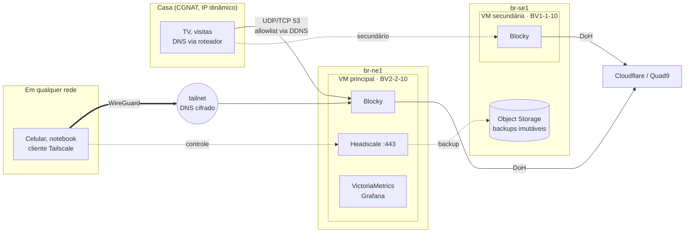

# mgdn-platform

Plataforma pessoal na [Magalu Cloud](https://magalu.cloud): DNS com bloqueio de anúncios e
rastreadores que funciona **em casa e fora dela**, uma rede privada (tailnet) para acessar
tudo sem expor serviços na internet, e redundância entre regiões. Tudo em VMs pequenas,
com orçamento-alvo de **R$ 100/mês**.

É a evolução do [blocky-cloud-dns](https://github.com/MarcosDaNight/blocky-cloud-dns),
congelado na release [`1.0.0`](https://github.com/MarcosDaNight/blocky-cloud-dns/releases/tag/1.0.0).
O porquê da evolução está no [ADR 0004](docs/adr/0004-evolucao-do-blocky-cloud-dns.md).

> 🚧 **Em construção.** O roteiro abaixo mostra o que já está pronto.

## Arquitetura-alvo

## Decisões (ADRs)

| # | Decisão |
|---|---|
| [0001](docs/adr/0001-registrar-decisoes-de-arquitetura.md) | Registrar decisões de arquitetura |
| [0002](docs/adr/0002-vms-em-vez-de-kubernetes.md) | VMs com Docker Compose em vez de Kubernetes |
| [0003](docs/adr/0003-tailnet-com-headscale.md) | Tailnet com Headscale, com o Blocky como DNS dela |
| [0004](docs/adr/0004-evolucao-do-blocky-cloud-dns.md) | Evoluir o blocky-cloud-dns em vez de recomeçar |

## Orçamento

| Recurso | Região | R$/mês |
|---|---|---|
| VM principal BV2-2-10 (2 vCPU, 2 GB) | br-ne1 | 59,99 |
| VM secundária BV1-1-10 (1 vCPU, 1 GB) | br-se1 | ~35 |
| Object Storage, drills de DR, VMs efêmeras | — | centavos |
| Domínio próprio (futuro) | — | ~3,50 |
| **Total** | | **≈ 95–99** |

## Roteiro

Cada fase entrega algo utilizável e tem um critério de aceite verificável.

- [ ] **Fase 0: fundação.** Repositório, ADRs, CI e release `1.0.0` do v1.
- [ ] **Fase 1: tailnet.** VM principal herdando o IP do v1, Headscale e o Blocky como DNS da
  tailnet. *Aceite: o celular no 4G bloqueia anúncios e a porta 22 fica fechada para a
  internet.*
- [ ] **Fase 2: redundância.** Blocky secundário em br-se1. *Aceite: desligar a VM principal
  não derruba o DNS de casa.*
- [ ] **Fase 3: backup e DR.** Backup imutável entre regiões e restore drill mensal
  automatizado. *Aceite: RTO e RPO medidos e publicados.*
- [ ] **Fase 4: engenharia.** `terraform test`, SLOs com error budget, alertas com runbook,
  imagens fixadas por digest e varredura no CI.
- [ ] **Fase 5: apps pessoais**, só pela tailnet (Vaultwarden primeiro).
