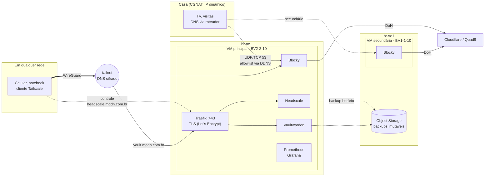

# mgdn-platform

Plataforma pessoal na [Magalu Cloud](https://magalu.cloud): DNS com bloqueio de anúncios e
rastreadores que funciona **em casa e fora dela**, uma rede privada (tailnet) para acessar
tudo sem expor serviços na internet, e redundância entre regiões. Tudo em VMs pequenas,
com orçamento-alvo de **R$ 100/mês**.

É a evolução do [blocky-cloud-dns](https://github.com/MarcosDaNight/blocky-cloud-dns),
congelado na release [`1.0.0`](https://github.com/MarcosDaNight/blocky-cloud-dns/releases/tag/1.0.0).
O porquê da evolução está no [ADR 0004](docs/adr/0004-evolucao-do-blocky-cloud-dns.md).

> 🚧 **Em construção.** Fases 0 a 4 concluídas, fase 5 em andamento.

## Arquitetura-alvo



## Decisões (ADRs)

| # | Decisão |
|---|---|
| [0001](docs/adr/0001-registrar-decisoes-de-arquitetura.md) | Registrar decisões de arquitetura |
| [0002](docs/adr/0002-vms-em-vez-de-kubernetes.md) | VMs com Docker Compose em vez de Kubernetes |
| [0003](docs/adr/0003-tailnet-com-headscale.md) | Tailnet com Headscale, com o Blocky como DNS dela |
| [0004](docs/adr/0004-evolucao-do-blocky-cloud-dns.md) | Evoluir o blocky-cloud-dns em vez de recomeçar |
| [0005](docs/adr/0005-dns-secundario-em-outra-regiao.md) | DNS secundário em outra região |
| [0006](docs/adr/0006-backup-imutavel-e-restore-drill.md) | Backup imutável do Headscale e restore drill mensal |
| [0007](docs/adr/0007-rotacao-dos-backups.md) | Rotação dos backups sem lifecycle do provedor |
| [0008](docs/adr/0008-cadeia-de-suprimentos.md) | Cadeia de suprimentos: digests fixos e varredura das imagens |
| [0009](docs/adr/0009-slo-e-alertas.md) | SLO do DNS com orçamento de erro e alertas no celular |
| [0010](docs/adr/0010-dominio-proprio-traefik-e-vaultwarden.md) | Domínio próprio, Traefik como borda HTTPS e Vaultwarden só na tailnet |

## Orçamento

| Recurso | Região | R$/mês |
|---|---|---|
| VM principal BV2-2-10 (2 vCPU, 2 GB) | br-ne1 | 59,99 |
| VM secundária BV1-1-10 (1 vCPU, 1 GB) | br-se1 | ~35 |
| Object Storage, drills de DR, VMs efêmeras | — | centavos |
| Domínio mgdn.com.br (Cloudflare DNS grátis) | — | ~3,50 |
| **Total (em produção desde 24/10/2026)** | | **≈ 95–99** |

## Estrutura

```
infra/                     Terraform (state remoto no Object Storage da Magalu)
  main.tf                  hosts da plataforma e import do IP herdado do v1
  dns.tf                   zona mgdn.com.br na Cloudflare (registros como código)
  modules/host/            uma VM: security group, IP público protegido, cloud-init
deploy/                    o que roda nas VMs (fonte da verdade do GitOps)
  common/blocky/           configuração do Blocky, compartilhada pelos papéis
  primary/compose.yaml     headscale, blocky, prometheus, node-exporter, grafana
  primary/headscale/       configuração do Headscale (DNS da tailnet = Blocky)
  primary/traefik/         borda HTTPS: Headscale e apps da tailnet (certificados por DNS-01)
  primary/backup/          chave pública age que cifra os backups
  primary/blackbox/        sondas DNS (resolve e bloqueia) que alimentam o SLI
  primary/prometheus/      coleta, regras de SLO/alertas (rules/) e testes (tests/)
  primary/alertmanager/    envio dos alertas ao ntfy
  secondary/compose.yaml   só o Blocky (DNS secundário em br-se1)
  systemd/                 timers: gitops, healthcheck, allowlist, limpeza semanal
scripts/
  gitops-sync.sh           por papel: validar → aplicar → verificar → rollback
  tailnet-join.sh          registra a VM principal na tailnet (100.64.0.1)
  allowlist.sh             porta 53 pública só para o IP de casa (DDNS)
  healthcheck.sh           DNS, bloqueio, tráfego de casa, disco, Headscale, DNS da tailnet
  backup.sh / restore.sh   backup cifrado e imutável do Headscale; restore automático no boot
  prune.sh / retention.py  rotação: 30 dias de diários + 12 mensais (mín. 7)
  s3.sh                    cliente S3 mínimo (curl --aws-sigv4)
docs/adr/                  decisões de arquitetura
docs/runbooks/             o que fazer quando cada alerta tocar
```

## Operação

`make help` lista tudo. O acesso às VMs é **pela tailnet** (`HOST=mgdn-primary`).

| Comando | O que faz |
|---|---|
| `make status [HOST=mgdn-secondary]` | commit aplicado, containers, tailnet, timers, RAM e disco |
| `make test` | resolve e bloqueia nas duas VMs (IPs públicos) e pela tailnet |
| `make tailnet-nodes` | aparelhos na tailnet |
| `make tailnet-register AUTH_ID=… NAME=…` | aprova (e nomeia) um aparelho novo |
| `make allowlist` | IP de casa liberado na porta 53 e últimas trocas |
| `make querylog` / `make logs` | domínios bloqueados / logs dos containers |
| `make tunnel` | Grafana, Prometheus e API do Blocky em `localhost` |
| `make backup` / `make backups` | backup do Headscale agora / lista os backups no bucket |

### Colocar um aparelho na tailnet

- **iPhone/Android:** no app do Tailscale, toque em *Log in…*, abra o menu **⋯** no canto
  superior direito, escolha *Use custom coordination server* e informe
  `https://headscale.mgdn.com.br`. O app mostra
  `headscale auth register --auth-id <id> --user USERNAME`: rode
  `make tailnet-register AUTH_ID=<id> NAME=iphone` (o iOS se registra como `localhost`;
  o `NAME` renomeia). Em *DNS settings*, mantenha **Use Tailscale DNS settings** ligado.
- **Linux:** `sudo tailscale up --login-server https://headscale.mgdn.com.br --authkey <chave>`,
  com a chave gerada por `make tailnet-key` (uso único, vale 30 min).

Com o aparelho na tailnet, o DNS dele passa a ser o Blocky (`100.64.0.1`) em qualquer rede.

### DNS secundário (VM em br-se1)

- **Roteador:** em *Servidor DHCP*, DNS primário = `primary_ip` e DNS secundário =
  `secondary_ip` (`terraform -chdir=infra output`). As duas VMs bloqueiam igual.
- **Recriar a secundária:** ela entra na tailnet com uma chave de uso único. Gere com
  `make tailnet-key`, coloque em `secondary_tailnet_authkey` no `terraform.tfvars` e rode
  `make apply` em até 30 min.
- Cada VM pinga o próprio check no healthchecks.io (`healthcheck_url` e
  `secondary_healthcheck_url`).

### Backup e DR (ADR 0006)

- **O que é salvo:** banco e chave Noise do Headscale, o cofre do Vaultwarden (ADR 0010),
  os certificados do Traefik e o estado do Tailscale da VM principal. **De hora em hora**,
  cifrado com `age`, num bucket com
  **object lock de 30 dias** em br-se1. Nem as credenciais do dono apagam um backup recente.
- **VM principal recriada:** o primeiro deploy restaura o backup mais recente antes de subir
  o Headscale. Os aparelhos seguem na tailnet e a VM volta como `100.64.0.1`. **Antes do
  `make apply`, rode `make headscale-drain`**: ele faz um backup novo e para o Headscale de
  forma limpa. Sem isso, clientes Linux com conexão longa ficam até ~15 min presos a uma
  conexão TCP meio aberta com a VM destruída (o túnel de dados não cai nesse meio-tempo).
- **Rotação (ADR 0007):** depois de cada backup, mantém todos os dos últimos 30 dias, o
  primeiro de cada mês por 12 meses e nunca menos de 7 (~43 no total). A Magalu não oferece
  lifecycle, então a rotação roda na VM; o object lock impede que algo com menos de 30 dias
  seja apagado, mesmo por engano. Simulação: `sudo /opt/mgdn-platform/scripts/prune.sh --dry-run`.
- **Restore drill:** todo dia 2 o workflow `dr-drill` restaura o backup num runner
  descartável, confere os nós e abre uma issue `dr-drill` com RTO e RPO. Uma falha fica
  aberta e notifica. Para rodar fora de hora: *Actions → dr-drill → Run workflow*.
- **Restore manual** (ex.: voltar a um backup específico): na VM principal,
  `sudo /opt/mgdn-platform/scripts/restore.sh --with-tailscale headscale/<AAAAMMDDTHHMMSSZ>.tar.gz.age`
  com o Headscale parado (`docker compose stop headscale`), e depois `start`.
- **Chave privada `age`:** guardada no gerenciador de senhas. Sem ela, nenhum backup pode
  ser lido.
- **VM secundária recriada:** ela não tem estado, então entra na tailnet como um nó novo, com
  outro IP. Remova o nó antigo (`make tailnet-nodes`, depois `headscale nodes delete -i <id>`)
  e atualize o IP dela em `dns.nameservers.global` no Headscale (PR).

### SLO e alertas (ADR 0009)

- **SLO: 99,9% em 30 dias** para "o DNS resolve e bloqueia" (~43 min/mês de orçamento de
  erro). Sondas a cada 30 s nos dois Blockys; o dashboard **SLO do DNS** (`make tunnel`,
  Grafana) mostra a disponibilidade, o orçamento restante e a taxa de consumo.
- **Alertas no celular (ntfy):** queda real (queima rápida do orçamento), degradação
  (queima lenta), um resolver fora (perda de redundância) e alvo sem coleta. Cada um aponta
  para um runbook em [`docs/runbooks/`](docs/runbooks/).
- **Configurar:** instale o app **ntfy**, assine o tópico secreto e coloque
  `https://ntfy.sh/<tópico>?template=alertmanager` em `alert_ntfy_url`. Isso recria a
  principal: rode `make headscale-drain` antes.
- As regras têm testes (`promtool test rules`, em `deploy/primary/prometheus/tests/`)
  rodados no CI e na VM antes de cada deploy.

### Checklist mensal

Todo dia 1º o workflow `monthly-checklist` abre uma issue atribuída ao dono do repo com as
verificações do mês: confirmar o hostname no No-IP, os três checks do healthchecks.io, a
issue do DR drill, os aparelhos da tailnet, os PRs do Dependabot e os prazos das
credenciais. Para abrir fora de hora: *Actions → monthly-checklist → Run workflow*.

### SSH de emergência (break-glass)

Se a tailnet estiver fora, defina `ssh_break_glass = true` no `terraform.tfvars` e rode
`make apply`: abre a porta 22 no security group, ainda filtrada pelo allowlist de casa,
**sem recriar a VM**. Acesse com `make ssh HOST=<IP público>` e desligue depois.

## Roteiro

Cada fase entrega algo utilizável e tem um critério de aceite verificável.

- [x] **Fase 0: fundação.** Repositório, ADRs, CI e release `1.0.0` do v1.
- [x] **Fase 1: tailnet.** VM principal herdando o IP do v1, Headscale e o Blocky como DNS da
  tailnet. *Aceite: o celular no 4G bloqueia anúncios e a porta 22 fica fechada para a
  internet.* Concluída em 24/10/2026: a troca do v1 deixou a casa ~5 min sem DNS; o iPhone
  no 4G passa pelo Blocky; a porta 22 fecha com 100% de perda em sondas externas.
- [x] **Fase 2: redundância.** Blocky secundário em br-se1. *Aceite: desligar a VM principal
  não derruba o DNS de casa.* Concluída em 24/10/2026: com o Blocky da principal parado, o
  resolvedor do sistema seguiu respondendo pela secundária (90–170 ms) e bloqueando; o log
  da secundária registrou as consultas.
- [x] **Fase 3: backup e DR.** Backup imutável entre regiões e restore drill mensal
  automatizado. *Aceite: RTO e RPO medidos e publicados.* Concluída em 24/10/2026:

  | Medição | Resultado |
  |---|---|
  | Restore drill (runner descartável) | RTO **6 s**, RPO **0 h** ([issue #9](https://github.com/MarcosDaNight/mgdn-platform/issues/9)) |
  | Recriação real da VM principal: apply → Headscale servindo o estado restaurado | **172 s** |
  | RPO da recriação (backup → apply) | **6 min** |
  | DNS fora do ar durante a recriação | **0** (a secundária atendeu casa e tailnet) |
  | Aparelhos que precisaram entrar de novo | **0** (mesmas `machine_key` e IPs) |
- [x] **Fase 4: engenharia.** Concluída em 24/10/2026:
  - IP real dos clientes da tailnet no Blocky (a causa era o SNAT do próprio Tailscale);
  - checklist mensal;
  - imagens por digest, Actions por SHA e Trivy no CI ([ADR 0008](docs/adr/0008-cadeia-de-suprimentos.md));
  - SLO 99,9% com alertas por burn rate no celular, runbooks e a secundária monitorada
    ([ADR 0009](docs/adr/0009-slo-e-alertas.md)), com as regras cobertas por `promtool test rules`;
  - `terraform test` com provider simulado: portas, break-glass, pacotes e credenciais por
    host, validações. Inclui a regressão do PR #10, com teste de mutação comprovando que ela
    é pega.
- [ ] **Fase 5: apps pessoais**, só pela tailnet ([ADR 0010](docs/adr/0010-dominio-proprio-traefik-e-vaultwarden.md)).
  - [x] Domínio `mgdn.com.br` com DNS como código; Traefik como borda HTTPS; Headscale atrás dele.
  - [x] **Vaultwarden** em `https://vault.mgdn.com.br`: só pela tailnet (403 de fora), backup
    horário, restore automático e drill mensal.
  - [ ] Migrar os aparelhos para `headscale.mgdn.com.br` e aposentar o DuckDNS.
