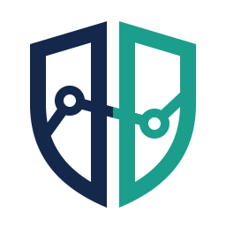
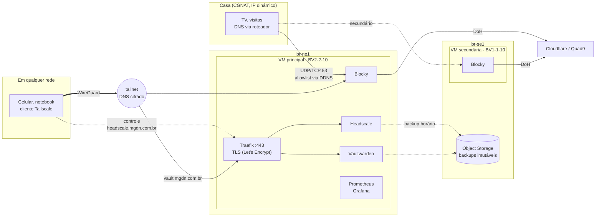
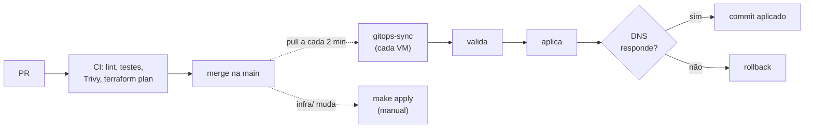

<p align="center">
  <picture>
    <source media="(prefers-color-scheme: dark)" srcset="icons/mgdn-icon-dark.svg">
    
  </picture>
</p>

# mgdn-platform

[](https://github.com/MarcosDaNight/mgdn-platform/actions/workflows/ci.yml)
[](https://github.com/MarcosDaNight/mgdn-platform/actions/workflows/supply-chain.yml)
[](https://github.com/MarcosDaNight/mgdn-platform/actions/workflows/dr-drill.yml)
[](LICENSE)

Plataforma pessoal na [Magalu Cloud](https://magalu.cloud). Ela oferece:

- **DNS com bloqueio de anúncios e rastreadores**, em casa e fora dela;
- **uma rede privada (tailnet)** para acessar tudo sem expor serviços na internet;
- **um gerenciador de senhas** (Vaultwarden) que só abre pela tailnet;
- **redundância entre regiões** e backups imutáveis.

Tudo roda em duas VMs pequenas, com orçamento de **~R$ 100/mês**, e é operado por IaC e
GitOps: o estado desejado vive neste repositório e as VMs se reconciliam sozinhas.

É a evolução do [blocky-cloud-dns](https://github.com/MarcosDaNight/blocky-cloud-dns),
congelado na release [`1.0.0`](https://github.com/MarcosDaNight/blocky-cloud-dns/releases/tag/1.0.0)
([ADR 0004](docs/adr/0004-evolucao-do-blocky-cloud-dns.md)).

## Sumário

- [Arquitetura](#arquitetura)
- [Como as mudanças chegam às VMs](#como-as-mudanças-chegam-às-vms)
- [Observabilidade](#observabilidade)
- [Segurança](#segurança)
- [Operação](#operação)
- [Decisões (ADRs)](#decisões-adrs)
- [Orçamento](#orçamento)
- [Estrutura do repositório](#estrutura-do-repositório)
- [Histórico](#histórico)
- [Próximos passos](#próximos-passos)
- [Contribuindo](#contribuindo)
- [Licença](#licença)

## Arquitetura



| Componente | Onde | Papel |
|---|---|---|
| **Blocky** | as duas VMs | DNS com bloqueio; upstream por DoH (Cloudflare e Quad9) |
| **Headscale** | principal | servidor de controle da tailnet; o Blocky é o DNS dela ([ADR 0003](docs/adr/0003-tailnet-com-headscale.md)) |
| **Traefik** | principal | borda HTTPS com certificados por DNS-01, sem socket do Docker |
| **Vaultwarden** | principal | cofre de senhas em `vault.mgdn.com.br`, só pela tailnet |
| **Actual Budget** | principal | finanças pessoais em `actual.mgdn.com.br`, só pela tailnet ([ADR 0012](docs/adr/0012-actual-budget-e-dados-bancarios.md)) |
| **Prometheus, Alertmanager, Grafana, blackbox** | principal | métricas, SLO, alertas no celular (ntfy) e dashboards |
| **node-exporter** | as duas VMs | métricas do host e do GitOps |
| **Object Storage** | br-se1 | backups cifrados com object lock de 30 dias |
| **Cloudflare** | — | DNS público de `mgdn.com.br`, gerenciado como código |

**Rede.** Na porta 53 pública, só o IP de casa é aceito. Ele é atualizado por DDNS. Fora de
casa, os aparelhos usam o Blocky (`100.64.0.1`, com `100.64.0.4` de reserva) pela tailnet.
A porta 22 fica fechada para a internet, e o SSH também passa pela tailnet.

## Como as mudanças chegam às VMs

O merge na `main` é o deploy. Nenhuma credencial de produção sai das VMs, e nenhum agente
externo tem acesso a elas.



### Aplicações (GitOps pull-based)

O `mgdn-gitops.timer` roda [`scripts/gitops-sync.sh`](scripts/gitops-sync.sh) em cada VM.
Ele aplica `deploy/<papel>/compose.yaml`, em que o papel é `primary` ou `secondary`.

1. **Valida** o commit novo antes de tocar em qualquer coisa: `compose config`, a
   configuração do Blocky, `promtool check` e `promtool test rules`, `amtool`, o blackbox e o
   `headscale configtest`.
2. **Aplica:** units do systemd, imagens e containers. Também reinicia os serviços cuja
   configuração mudou.
3. **Verifica:** o DNS tem de responder em até ~1 min. Se não responder, volta ao último commit
   bom e marca o novo como falho.
4. **Self-heal:** sem commit novo, roda `compose up -d`. Um container parado ou removido à mão
   volta ao estado do Git em até ~2 min. Cada correção conta em
   `mgdn_gitops_drift_corrections_total`.

Por que isso e não ArgoCD: [ADR 0011](docs/adr/0011-gitops-sem-argocd.md).

### Infraestrutura (Terraform)

- O state fica num bucket da Magalu. A Cloudflare (DNS) também é gerenciada como código
  ([`infra/dns.tf`](infra/dns.tf)).
- **Em todo PR que mexe em `infra/`**, o workflow `terraform-plan` comenta o resultado do
  plano, só com ações e endereços. Recriar uma VM ou um IP público ganha um aviso ⚠️.
- O workflow usa uma chave **só de leitura**. O apply continua manual (`make apply`). Ele
  mostra o plano, pede confirmação e, se a principal for recriada, roda o
  `make headscale-drain` sozinho antes de aplicar o mesmo plano.
- Os secrets são `TF_PLAN_MGC_API_KEY`, `TF_PLAN_STATE_ACCESS_KEY`,
  `TF_PLAN_STATE_SECRET_KEY` e `TF_PLAN_TFVARS`. Sem eles, o plano é pulado.

### Workflows do GitHub

| Workflow | Quando | O que faz |
|---|---|---|
| `ci` | PR e push | pre-commit, `terraform validate` e `test`, `compose config`, `promtool test rules` |
| `supply-chain` | PR, push e semanal | Trivy em todas as imagens do Compose: CRITICAL com correção disponível bloqueia ([ADR 0008](docs/adr/0008-cadeia-de-suprimentos.md)) |
| `terraform-plan` | PR em `infra/` | plano comentado no PR (acima) |
| `dependabot-auto-merge` | PR do Dependabot | **patch** de tudo e **minor** de imagens entram sozinhos depois do CI verde; o resto espera revisão |
| `dr-drill` | todo dia 2 | restaura o backup num runner descartável e publica RTO e RPO numa issue |
| `monthly-checklist` | todo dia 1º | abre a issue com as verificações manuais do mês |
| `deadlines` | diário | abre uma issue 30 dias antes de cada prazo de `.github/deadlines.yml` (chaves, token, domínio) |

A `main` é protegida: todo merge precisa de PR e dos checks `terraform`, `deploy-config`
(primary e secondary), `pre-commit` e `supply-chain`.

## Observabilidade

Os painéis ficam em `make tunnel`, que abre o Grafana em `localhost:3000`.

| Dashboard | Mostra |
|---|---|
| **SLO do DNS** | disponibilidade em 30 dias, orçamento de erro restante e taxa de consumo |
| **Plataforma (GitOps)** | commit aplicado por host, resultado e idade do último sync, correções de desvio |
| **Blocky** | consultas, bloqueios, cache e latência |
| **Node Exporter** | CPU, RAM, disco e rede das VMs |

### SLO e alertas ([ADR 0009](docs/adr/0009-slo-e-alertas.md))

- **SLO: 99,9% em 30 dias** para "o DNS resolve e bloqueia". O orçamento de erro é de
  ~43 min/mês. As sondas rodam a cada 30 s nos dois Blockys.
- **Os alertas chegam no celular pelo ntfy.** Cada um aponta para um runbook em
  [`docs/runbooks/`](docs/runbooks/).

  | Alerta | Runbook |
  |---|---|
  | Queda real (queima rápida do orçamento) ou degradação (queima lenta) | [dns-error-budget](docs/runbooks/dns-error-budget.md) |
  | Um resolver fora (perda de redundância) | [dns-resolver-down](docs/runbooks/dns-resolver-down.md) |
  | Alvo sem coleta | [monitoring-target-down](docs/runbooks/monitoring-target-down.md) |
  | GitOps falhando, atrasado, parado ou corrigindo desvio em loop | [gitops](docs/runbooks/gitops.md) |
  | Disco enchendo, RAM baixa, OOM, certificado sem renovar, aparelho sumido da tailnet há 30 dias | [host](docs/runbooks/host.md) |
  | O healthchecks.io parou de receber o Watchdog (caminho de alertas quebrado) | [watchdog](docs/runbooks/watchdog.md) |

- **Configurar:** instale o app **ntfy**, assine o tópico secreto e grave
  `https://ntfy.sh/<tópico>?template=alertmanager` com
  `make secrets-set ROLE=primary KEY=ALERT_NTFY_URL`. Um PR aplica, sem recriar a VM.
- As regras têm testes em `deploy/primary/prometheus/tests/`. Eles rodam no CI e na VM antes
  de cada deploy.

### Vigilância por fora da plataforma

O Prometheus e o Alertmanager rodam na principal. Para não depender só deles, quatro checks
do healthchecks.io avisam por fora, pela integração de ntfy e por e-mail:

| Check | Quem pinga | Pega |
|---|---|---|
| **principal** e **secundária** | o `healthcheck.sh` de cada VM, a cada 5 min | VM fora do ar, DNS sem resolver ou sem bloquear, disco cheio e, na principal, qualquer app com `mgdn.url` fora do ar |
| **backup** | o `backup.sh`, de hora em hora | backup parado ou falhando |
| **watchdog** | o Alertmanager, com o alerta `Watchdog` sempre disparando, a cada 1–2 min | caminho de alertas quebrado com a VM no ar ([ADR 0013](docs/adr/0013-dead-mans-switch-com-healthchecks.md)) |

A URL do watchdog vai em `ALERT_WATCHDOG_URL`, nos segredos da principal. A configuração do check (período, grace e
canais) e o teste de aceite estão no [runbook](docs/runbooks/watchdog.md).

## Segurança

- **Superfície mínima:** a porta 53 só aceita o IP de casa, a 443 serve o Traefik e a 22 fica
  fechada. O Vaultwarden e os painéis só abrem pela tailnet. Fora dela, o Vaultwarden responde
  403, e o nome `vault.mgdn.com.br` nem existe no DNS público.
- **Segredos cifrados no repositório ([ADR 0014](docs/adr/0014-segredos-cifrados-no-repositorio.md)):**
  - tokens, URLs de ping, credenciais do backup e o IP de casa ficam em
    `secrets/<papel>.env.age`, cifrados com `age` para a chave do host e a de administração;
  - trocar um segredo é um PR (`make secrets-edit ROLE=primary`), sem recriar VM;
  - o cloud-init leva só a chave age de cada host;
  - os containers leem os segredos de arquivos com permissão restrita.
- **Backups:**
  - são cifrados com `age`; a chave privada fica no gerenciador de senhas;
  - ficam num bucket com object lock COMPLIANCE, que nem o dono apaga antes de 30 dias.
- **Cadeia de suprimentos:**
  - imagens e Actions são fixadas por hash;
  - o Trivy roda em todo PR;
  - o Dependabot propõe as atualizações.
- **Repositório público:** IP de casa, hostname do DDNS, URLs de healthcheck e tópicos do ntfy
  nunca entram no Git em claro. O plano do Terraform no PR mostra só endereços, nunca valores.

## Operação

`make help` lista tudo. O acesso às VMs é **pela tailnet** (`HOST=mgdn-primary`).

| Comando | O que faz |
|---|---|
| `make status [HOST=mgdn-secondary]` | commit aplicado, containers, tailnet, timers, RAM e disco |
| `make sync` | força o GitOps sync agora |
| `make test` | resolve e bloqueia nas duas VMs (IPs públicos) e pela tailnet |
| `make tailnet-nodes` | aparelhos na tailnet |
| `make tailnet-register AUTH_ID=… NAME=…` | aprova (e nomeia) um aparelho novo |
| `make allowlist` | IP de casa liberado na porta 53 e últimas trocas |
| `make querylog` / `make logs` | domínios bloqueados / logs dos containers |
| `make tunnel` | Grafana, Prometheus, Alertmanager e API do Blocky em `localhost` |
| `make backup` / `make backups` | backup agora / lista os backups no bucket |
| `make plan` / `make apply` | Terraform local (credenciais em `.env`) |
| `make lint` / `make test-infra` | pre-commit e `terraform test` |
| `make new-app NAME=… IMAGE=… PORT=…` | gera um app só da tailnet (Compose, Traefik, Blocky e labels de backup) |

### Adicionar um app

`make new-app` gera o serviço no Compose, a rota no Traefik com `tailnet-only` e o nome na
tailnet pelo Blocky. Os labels `mgdn.*` do serviço
([ADR 0015](docs/adr/0015-contrato-de-app-por-labels.md)) colocam o app no backup, no
restore de VM nova, no healthcheck e no DR drill, sem mexer em nenhum script. O passo a passo
está em [`docs/adicionar-app.md`](docs/adicionar-app.md).

### Mudar a configuração do Blocky

Edite [`deploy/common/blocky/config.yml`](deploy/common/blocky/config.yml) (listas,
allowlists, `customDNS`) e abra um PR. Com o CI verde e o merge, as duas VMs aplicam em até
2 min. Se o Blocky não subir, o rollback é automático.

### Colocar um aparelho na tailnet

- **iPhone/Android:**
  1. No app do Tailscale, toque em *Log in…*.
  2. Abra o menu **⋯** no canto superior direito e escolha *Use custom coordination server*.
  3. Informe `https://headscale.mgdn.com.br`.
  4. O app mostra `headscale auth register --auth-id <id> --user USERNAME`. Rode
     `make tailnet-register AUTH_ID=<id> NAME=iphone`. O iOS se registra como `localhost`, e o
     `NAME` o renomeia.
  5. Em *DNS settings*, mantenha **Use Tailscale DNS settings** ligado.
- **Linux:** rode `sudo tailscale up --login-server https://headscale.mgdn.com.br --authkey <chave>`.
  A chave vem de `make tailnet-key`; é de uso único e vale 30 min.

Com o aparelho na tailnet, o DNS dele passa a ser o Blocky (`100.64.0.1`) em qualquer rede.

### DNS secundário (VM em br-se1)

- **Roteador:** em *Servidor DHCP*, use `primary_ip` como DNS primário e `secondary_ip` como
  secundário (`terraform -chdir=infra output`). As duas VMs bloqueiam igual.
- **Recriar a secundária:** `make apply`. A identidade dela na tailnet fica nos segredos
  (`TAILSCALED_STATE_B64`, ADR 0014), então ela volta como o mesmo nó, em `100.64.0.4`, sem
  chave de uso único. Para atualizar a identidade guardada: `make secrets-capture-identity`
  e um PR.

### Backup e DR ([ADR 0006](docs/adr/0006-backup-imutavel-e-restore-drill.md))

- **O que é salvo, de hora em hora:**
  - o volume de todo serviço com o label `mgdn.backup.volume`
    ([ADR 0015](docs/adr/0015-contrato-de-app-por-labels.md)), com snapshot consistente de cada
    SQLite: hoje, o Headscale (banco e chave Noise), o cofre do Vaultwarden, os orçamentos e a
    conta do Actual Budget e os certificados do Traefik;
  - o estado do Tailscale da VM principal.
- **Recriar a VM principal:** o `make apply` roda o `make headscale-drain` antes, sozinho.
  - O drain faz um backup novo e para o Headscale de forma limpa.
  - Sem ele, clientes Linux com conexão longa ficam até ~15 min presos a uma conexão TCP meio
    aberta com a VM destruída.
  - O primeiro deploy restaura o backup mais recente antes de subir os serviços. Os aparelhos
    seguem na tailnet e a VM volta como `100.64.0.1`.
- **Rotação ([ADR 0007](docs/adr/0007-rotacao-dos-backups.md)):**
  - Guarda todos os backups dos últimos 30 dias e o primeiro de cada mês por 12 meses,
    nunca menos de 7 (~43 no total).
  - Roda do lado do cliente, na VM, logo depois de cada backup.
  - Simulação: `sudo /opt/mgdn-platform/scripts/prune.sh --dry-run`.
- **Restore drill:** fora de hora, use *Actions → dr-drill → Run workflow*. Uma falha deixa a
  issue aberta e notifica.
- **Restore manual de um backup específico:** na VM principal, pare o Headscale
  (`docker compose stop headscale`), rode
  `sudo /opt/mgdn-platform/scripts/restore.sh --with-tailscale headscale/<AAAAMMDDTHHMMSSZ>.tar.gz.age`
  e depois `start`.

### SSH de emergência (break-glass)

Se a tailnet estiver fora:

1. Defina `ssh_break_glass = true` no `terraform.tfvars` e rode `make apply`. Isso abre a
   porta 22, ainda filtrada pelo allowlist de casa, **sem recriar a VM**.
2. Acesse com `make ssh HOST=<IP público>`.
3. Desligue a opção depois.

### DDNS de casa pela Cloudflare (opcional)

O allowlist da porta 53 segue o IP de casa por um hostname DDNS (`HOME_DDNS_HOST`). No
No-IP gratuito, esse hostname expira se não for confirmado a cada 30 dias. A alternativa é
um registro em `mgdn.com.br`, atualizado de casa pela API da Cloudflare, que não expira.

- **Contrapartida:** o IP de casa passa a ficar ligado ao seu domínio no DNS público. Use um
  nome difícil de adivinhar; o No-IP também publica o IP, só que sob um domínio genérico.
- **Requisito:** um computador Linux sempre ligado em casa. O roteador não serve, porque em
  geral só fala com o No-IP e o DynDNS.

Para trocar:

1. Crie na Cloudflare um token **novo** com `DNS:Edit` só em `mgdn.com.br` (não reaproveite o
   do Terraform).
2. No computador de casa, clone o repositório em `~/mgdn-platform` e crie
   `~/.config/mgdn-platform/home-ddns.env` (0600) com `CF_API_TOKEN`, `CF_ZONE_ID` e
   `DDNS_NAME`. O formato está no topo de [`scripts/home-ddns.sh`](scripts/home-ddns.sh).
3. Rode `scripts/home-ddns.sh` uma vez e confira com `dig +short <DDNS_NAME>`.
4. Ative o timer:

   ```bash
   cp deploy/home/mgdn-home-ddns.* ~/.config/systemd/user/
   systemctl --user enable --now mgdn-home-ddns.timer
   loginctl enable-linger "$USER"   # roda mesmo sem sessão aberta
   ```

5. Troque `HOME_DDNS_HOST` nos segredos das duas VMs pelo `DDNS_NAME` e abra um PR. As VMs
   passam a seguir o nome novo em até ~2 min.
6. Confira com `make allowlist`. Depois, apague o hostname no No-IP e tire o item dele do
   checklist mensal.

### Checklist mensal

Todo dia 1º, uma issue lista o que não dá para automatizar:

- o hostname no No-IP (até a troca pelo DDNS da Cloudflare);
- os checks do healthchecks.io;
- a issue do DR drill;
- aparelhos estranhos na tailnet (os sumidos há 30 dias já viram alerta);
- os PRs do Dependabot que esperam revisão (major e minor de Actions e providers).

Disco, RAM e certificados viraram alertas (`docs/runbooks/host.md`), e os prazos das
credenciais viraram issues automáticas (`.github/deadlines.yml`).

## Decisões (ADRs)

| # | Decisão |
|---|---|
| [0001](docs/adr/0001-registrar-decisoes-de-arquitetura.md) | Registrar decisões de arquitetura |
| [0002](docs/adr/0002-vms-em-vez-de-kubernetes.md) | VMs com Docker Compose em vez de Kubernetes |
| [0003](docs/adr/0003-tailnet-com-headscale.md) | Tailnet com Headscale, com o Blocky como DNS dela |
| [0004](docs/adr/0004-evolucao-do-blocky-cloud-dns.md) | Evoluir o blocky-cloud-dns em vez de recomeçar |
| [0005](docs/adr/0005-dns-secundario-em-outra-regiao.md) | DNS secundário em outra região |
| [0006](docs/adr/0006-backup-imutavel-e-restore-drill.md) | Backup imutável do Headscale e restore drill mensal |
| [0007](docs/adr/0007-rotacao-dos-backups.md) | Rotação dos backups sem lifecycle do provedor |
| [0008](docs/adr/0008-cadeia-de-suprimentos.md) | Cadeia de suprimentos: digests fixos e varredura das imagens |
| [0009](docs/adr/0009-slo-e-alertas.md) | SLO do DNS com orçamento de erro e alertas no celular |
| [0010](docs/adr/0010-dominio-proprio-traefik-e-vaultwarden.md) | Domínio próprio, Traefik como borda HTTPS e Vaultwarden só na tailnet |
| [0011](docs/adr/0011-gitops-sem-argocd.md) | GitOps sem ArgoCD: self-heal, plano no PR e auto-merge de patches |
| [0012](docs/adr/0012-actual-budget-e-dados-bancarios.md) | Actual Budget e dados bancários sem Open Finance pago |
| [0013](docs/adr/0013-dead-mans-switch-com-healthchecks.md) | Dead man's switch do caminho de alertas com o healthchecks.io |
| [0014](docs/adr/0014-segredos-cifrados-no-repositorio.md) | Segredos cifrados no repositório com age |
| [0015](docs/adr/0015-contrato-de-app-por-labels.md) | Contrato de app por labels do Compose |

As fontes por trás de cada decisão (SRE, GitOps, Tailscale, Let's Encrypt etc.) estão em
[`docs/referencias.md`](docs/referencias.md).

## Orçamento

| Recurso | Região | R$/mês |
|---|---|---|
| VM principal BV2-2-10 (2 vCPU, 2 GB) | br-ne1 | 59,99 |
| VM secundária BV1-1-10 (1 vCPU, 1 GB) | br-se1 | ~35 |
| Object Storage, drills de DR, VMs efêmeras | — | centavos |
| Domínio mgdn.com.br (Cloudflare DNS grátis) | — | ~3,50 |
| **Total (em produção desde 24/10/2026)** | | **≈ 95–99** |

## Estrutura do repositório

```
infra/                     Terraform (state remoto no Object Storage da Magalu)
  main.tf                  hosts da plataforma e import do IP herdado do v1
  dns.tf                   zona mgdn.com.br na Cloudflare (registros como código)
  modules/host/            uma VM: security group, IP público protegido, cloud-init
  tests/                   terraform test com provider simulado
deploy/                    o que roda nas VMs (fonte da verdade do GitOps)
  common/blocky/           configuração do Blocky, compartilhada pelos papéis
  common/platform.env      nomes públicos da plataforma (hostname do Headscale)
  primary/compose.yaml     traefik, headscale, vaultwarden, actual, blocky e monitoramento;
                           os labels mgdn.* de cada serviço são o contrato de app (ADR 0015)
  primary/headscale/       configuração do Headscale (DNS da tailnet = Blocky)
  primary/traefik/         borda HTTPS: Headscale e apps da tailnet (certificados por DNS-01)
  primary/backup/          chave pública age que cifra os backups
  primary/blackbox/        sondas DNS (resolve e bloqueia) que alimentam o SLI
  primary/prometheus/      coleta, regras de SLO, GitOps, host e tailnet (rules/) e testes (tests/)
  primary/alertmanager/    envio dos alertas ao ntfy
  primary/grafana/         datasource e dashboards provisionados
  secondary/compose.yaml   Blocky e node-exporter (DNS secundário em br-se1)
  systemd/                 timers: gitops, healthcheck, allowlist, backup, limpeza semanal
  home/                    timer opcional do DDNS de casa (roda em casa, não nas VMs)
scripts/
  gitops-sync.sh           por papel: validar → aplicar → verificar → rollback; self-heal e métricas
  tailnet-join.sh          registra a VM na tailnet
  allowlist.sh             porta 53 pública só para o IP de casa (DDNS)
  healthcheck.sh           DNS, bloqueio, tráfego de casa, disco, Headscale, DNS da tailnet, apps
  apps.py                  lê os labels mgdn.* para backup, restore, healthcheck e DR drill
  new-app.py               `make new-app`: serviço, rota no Traefik e nome no Blocky
  backup.sh / restore.sh   backup cifrado e imutável dos volumes marcados; restore no primeiro deploy
  prune.sh / retention.py  rotação: 30 dias de diários + 12 mensais (mín. 7)
  s3.sh                    cliente S3 mínimo (curl --aws-sigv4)
  deadlines.py             prazos de .github/deadlines.yml (validação e aviso)
  home-ddns.sh             DDNS de casa pela API da Cloudflare (opcional)
icons/                     ícone (claro, escuro e monocromático) e a imagem de prévia do GitHub
docs/adr/                  decisões de arquitetura
docs/runbooks/             o que fazer quando cada alerta tocar
docs/adicionar-app.md      passo a passo para um app novo
docs/referencias.md        fontes por trás das decisões
.github/deadlines.yml      vencimentos de chaves, tokens e domínio
.github/workflows/         CI, supply chain, terraform plan, auto-merge, DR drill, checklist, prazos
```

## Histórico

A plataforma foi construída em fases, a partir de outubro de 2026. Cada fase entregou algo
utilizável e tem um critério de aceite verificável.

| Fase | Entrega | Aceite medido |
|---|---|---|
| 0. Fundação | repositório, ADRs, CI, release `1.0.0` do v1 | — |
| 1. Tailnet | VM principal herdando o IP do v1; Headscale; Blocky como DNS da tailnet | o iPhone no 4G passa pelo Blocky; a porta 22 tem 100% de perda em sondas externas; a troca deixou a casa ~5 min sem DNS |
| 2. Redundância | Blocky secundário em br-se1 | com o Blocky da principal parado, a casa seguiu resolvendo e bloqueando pela secundária (90–170 ms) |
| 3. Backup e DR | backup imutável entre regiões, restore drill mensal | veja a tabela abaixo |
| 4. Engenharia | IP real dos clientes no Blocky, checklist mensal, supply chain, SLO e alertas, `terraform test` (com teste de mutação) | — |
| 5. Apps pessoais | domínio `mgdn.com.br` como código, Traefik, Vaultwarden só na tailnet, migração dos aparelhos sem novo registro | Vaultwarden responde 403 fora da tailnet |
| Finalização | self-heal e métricas do GitOps, plano no PR, auto-merge de patches ([ADR 0011](docs/adr/0011-gitops-sem-argocd.md)) | um container parado à mão voltou sozinho no sync seguinte |
| Dead man's switch | alerta Watchdog → healthchecks.io, avisando por fora da plataforma ([ADR 0013](docs/adr/0013-dead-mans-switch-com-healthchecks.md)) | *a medir:* Alertmanager parado → aviso no celular, procedimento no [runbook](docs/runbooks/watchdog.md#teste-de-aceite) |
| Menos processos manuais | alertas de host e de aparelhos sumidos, prazos como código, auto-merge de minor das imagens, contrato de app por labels e `make new-app` ([ADR 0015](docs/adr/0015-contrato-de-app-por-labels.md)) | o primeiro backup feito pelo código novo na VM, restaurado pelo DR drill guiado pelos labels: Vaultwarden (110 itens) e Actual (1 orçamento) de pé, RTO 21 s ([issue #43](https://github.com/MarcosDaNight/mgdn-platform/issues/43)) |

**Medições de DR:**

| Medição | Resultado |
|---|---|
| Restore drill (runner descartável) | RTO **6 s**, RPO **0 h** ([issue #9](https://github.com/MarcosDaNight/mgdn-platform/issues/9)) |
| Recriação real da VM principal: do apply ao Headscale servindo o estado restaurado | **172 s** |
| RPO da recriação (do backup ao apply) | **6 min** |
| DNS fora do ar durante a recriação | **0** (a secundária atendeu a casa e a tailnet) |
| Aparelhos que precisaram entrar de novo | **0** (mesmas `machine_key` e IPs) |

## Próximos passos

Apps novos saem do `make new-app` ([guia](docs/adicionar-app.md)): só pela tailnet, com
HTTPS, healthcheck e backup.

- [ ] **Exit node na VM principal.** Não é um app novo, só uma opção do Tailscale
  ([docs](https://tailscale.com/kb/1103/exit-nodes)). Em Wi-Fi público, todo o tráfego do
  aparelho sai cifrado pela VM no Brasil. Antes, estime o custo do tráfego de saída.
- [ ] **ntfy próprio** ([docs](https://ntfy.sh/docs/install/)). Usa ~20 MB e tira os alertas
  da dependência de um tópico secreto no ntfy.sh público.
- [ ] **Tema do Actual Budget com a identidade da plataforma**, depois da 26.11.0: CSS com
  `#13284B` e `#1C9E8C` (claro) e `#E6EDF3` e `#2BC4AC` (escuro).
- [ ] **Actual Budget para uma segunda pessoa**, com finanças separadas. É preciso decidir
  duas coisas:
  - **Isolamento no Actual:**
    - *Segunda instância* (`actual-2`, com subdomínio, senha e volume próprios): ~40 MB de
      RAM e isolamento total: `make new-app NAME=actual-2 IMAGE=actualbudget/actual-server:<versão> PORT=5006 DATA=/data HEALTH=/health READY=server-files/account.sqlite`.
      **Recomendada para começar.**
    - *Modo multiusuário* do Actual: um servidor só, com permissão por orçamento. Exige um
      provedor OpenID, por exemplo o Pocket ID, que é leve e usa passkeys. Compensa se mais
      pessoas ou apps forem usar login único.
    - Uma instância compartilhada com a mesma senha não serve: cada um veria e poderia
      apagar os orçamentos do outro.
  - **Acesso pela tailnet:** os aparelhos dela entram num usuário próprio do Headscale, com
    uma política (ACL) que libera só o DNS do Blocky e a porta 443 do Traefik. Hoje, sem
    política, todos os nós se alcançam.
- [ ] **Talvez: importador de OFX para o Actual Budget**, num repositório separado. Só se a
  importação manual incomodar depois de um mês de uso
  ([ADR 0012](docs/adr/0012-actual-budget-e-dados-bancarios.md)).

## Contribuindo

Issues e PRs são bem-vindos. O fluxo, os checks e as convenções estão em
[`CONTRIBUTING.md`](CONTRIBUTING.md). Vulnerabilidades devem ser reportadas em privado, por
*Security → Report a vulnerability*.

## Licença

[MIT](LICENSE) © 2026 Marcos Guillermo.
