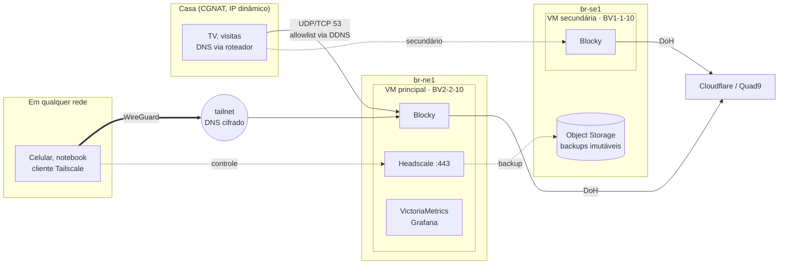

# mgdn-platform

Plataforma pessoal na [Magalu Cloud](https://magalu.cloud): DNS com bloqueio de anúncios e
rastreadores que funciona **em casa e fora dela**, uma rede privada (tailnet) para acessar
tudo sem expor serviços na internet, e redundância entre regiões. Tudo em VMs pequenas,
com orçamento-alvo de **R$ 100/mês**.

É a evolução do [blocky-cloud-dns](https://github.com/MarcosDaNight/blocky-cloud-dns),
congelado na release [`1.0.0`](https://github.com/MarcosDaNight/blocky-cloud-dns/releases/tag/1.0.0).
O porquê da evolução está no [ADR 0004](docs/adr/0004-evolucao-do-blocky-cloud-dns.md).

> 🚧 **Em construção.** Fases 0 e 1 concluídas; o roteiro abaixo mostra o restante.

## Arquitetura-alvo



## Decisões (ADRs)

| # | Decisão |
|---|---|
| [0001](docs/adr/0001-registrar-decisoes-de-arquitetura.md) | Registrar decisões de arquitetura |
| [0002](docs/adr/0002-vms-em-vez-de-kubernetes.md) | VMs com Docker Compose em vez de Kubernetes |
| [0003](docs/adr/0003-tailnet-com-headscale.md) | Tailnet com Headscale, com o Blocky como DNS dela |
| [0004](docs/adr/0004-evolucao-do-blocky-cloud-dns.md) | Evoluir o blocky-cloud-dns em vez de recomeçar |

## Orçamento

| Recurso | Região | R$/mês |
|---|---|---|
| VM principal BV2-2-10 (2 vCPU, 2 GB) | br-ne1 | 59,99 |
| VM secundária BV1-1-10 (1 vCPU, 1 GB) | br-se1 | ~35 |
| Object Storage, drills de DR, VMs efêmeras | — | centavos |
| Domínio próprio (futuro) | — | ~3,50 |
| **Total** | | **≈ 95–99** |

## Estrutura

```
infra/                     Terraform (state remoto no Object Storage da Magalu)
  main.tf                  hosts da plataforma e import do IP herdado do v1
  modules/host/            uma VM: security group, IP público protegido, cloud-init
deploy/                    o que roda nas VMs (fonte da verdade do GitOps)
  common/blocky/           configuração do Blocky, compartilhada pelos papéis
  primary/compose.yaml     headscale, blocky, prometheus, node-exporter, grafana
  primary/headscale/       configuração do Headscale (DNS da tailnet = Blocky)
  systemd/                 timers: gitops, healthcheck, allowlist, limpeza semanal
scripts/
  gitops-sync.sh           por papel: validar → aplicar → verificar → rollback
  tailnet-join.sh          registra a VM principal na tailnet (100.64.0.1)
  allowlist.sh             porta 53 pública só para o IP de casa (DDNS)
  healthcheck.sh           DNS, bloqueio, tráfego de casa, disco, Headscale, DNS da tailnet
docs/adr/                  decisões de arquitetura
```

## Operação

`make help` lista tudo. O acesso às VMs é **pela tailnet** (`HOST=mgdn-primary`).

| Comando | O que faz |
|---|---|
| `make status` | commit aplicado, containers, tailnet, timers, RAM e disco |
| `make test` | resolve e bloqueia pelo IP público e pela tailnet |
| `make tailnet-nodes` | aparelhos na tailnet |
| `make tailnet-register AUTH_ID=… NAME=…` | aprova (e nomeia) um aparelho novo |
| `make allowlist` | IP de casa liberado na porta 53 e últimas trocas |
| `make querylog` / `make logs` | domínios bloqueados / logs dos containers |
| `make tunnel` | Grafana, Prometheus e API do Blocky em `localhost` |

### Colocar um aparelho na tailnet

- **iPhone/Android:** no app do Tailscale, toque em *Log in…*, abra o menu **⋯** no canto
  superior direito, escolha *Use custom coordination server* e informe
  `https://mgdn-platform.duckdns.org`. O app mostra
  `headscale auth register --auth-id <id> --user USERNAME`: rode
  `make tailnet-register AUTH_ID=<id> NAME=iphone` (o iOS se registra como `localhost`;
  o `NAME` renomeia). Em *DNS settings*, mantenha **Use Tailscale DNS settings** ligado.
- **Linux:** `sudo tailscale up --login-server https://mgdn-platform.duckdns.org --authkey <chave>`,
  com a chave gerada por `make tailnet-key` (uso único, vale 30 min).

Com o aparelho na tailnet, o DNS dele passa a ser o Blocky (`100.64.0.1`) em qualquer rede.

### SSH de emergência (break-glass)

Se a tailnet estiver fora, defina `ssh_break_glass = true` no `terraform.tfvars` e rode
`make apply`: abre a porta 22 no security group, ainda filtrada pelo allowlist de casa,
**sem recriar a VM**. Acesse com `make ssh HOST=<IP público>` e desligue depois.

## Limitações conhecidas

- **Clientes da tailnet aparecem como `172.19.0.1` no Blocky.** As consultas que chegam pela
  tailnet passam pelo proxy do Docker e perdem o IP de origem. Bloqueio e cache funcionam;
  perde-se a separação por aparelho em logs e métricas (as consultas de casa mantêm o IP
  real). Correção prevista na fase 4.

## Roteiro

Cada fase entrega algo utilizável e tem um critério de aceite verificável.

- [x] **Fase 0: fundação.** Repositório, ADRs, CI e release `1.0.0` do v1.
- [x] **Fase 1: tailnet.** VM principal herdando o IP do v1, Headscale e o Blocky como DNS da
  tailnet. *Aceite: o celular no 4G bloqueia anúncios e a porta 22 fica fechada para a
  internet.* Concluída em 24/10/2026: a troca do v1 deixou a casa ~5 min sem DNS; o iPhone
  no 4G passa pelo Blocky; a porta 22 fecha com 100% de perda em sondas externas.
- [ ] **Fase 2: redundância.** Blocky secundário em br-se1. *Aceite: desligar a VM principal
  não derruba o DNS de casa.*
- [ ] **Fase 3: backup e DR.** Backup imutável entre regiões e restore drill mensal
  automatizado. *Aceite: RTO e RPO medidos e publicados.*
- [ ] **Fase 4: engenharia.** `terraform test`, SLOs com error budget, alertas com runbook,
  imagens fixadas por digest e varredura no CI, IP real dos clientes da tailnet no Blocky e
  checklist mensal (herdado do v1).
- [ ] **Fase 5: apps pessoais**, só pela tailnet (Vaultwarden primeiro).
