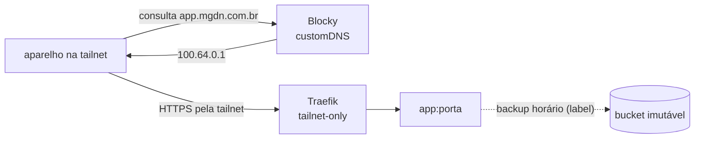

# Como adicionar um app

Este guia mostra como colocar um app novo na VM principal, acessível **só pela tailnet**,
com HTTPS, healthcheck e backup. O caminho é o mesmo do Vaultwarden e do
[Actual Budget](https://github.com/actualbudget/actual)
([ADR 0012](adr/0012-actual-budget-e-dados-bancarios.md)), e quase tudo sai de um comando
só: `make new-app`. O que o app precisa declarar está no
[contrato de app](adr/0015-contrato-de-app-por-labels.md).



## 0. Antes de começar

| Pergunta | Por quê |
|---|---|
| **Cabe na RAM?** | A principal tem 2 GB. O `make new-app` avisa quando a soma dos `mem_limit` passa do que ela comporta; confira o uso real com `make status`. Apps que pedem Postgres, Redis ou workers de ML (Immich, Paperless) geralmente não cabem. |
| **Guarda dados?** | Se guarda, passe `DATA=` e o volume entra no backup sozinho. Prefira apps com SQLite: o backup faz um snapshot consistente de cada banco sem parar o app. |
| **Precisa de segredo?** | Vai cifrado no repositório, sem Terraform e sem recriar a VM ([ADR 0014](adr/0014-segredos-cifrados-no-repositorio.md)). |
| **Muda uma decisão?** | Um app comum não precisa de ADR. Um app que exige uma porta pública nova ou outra VM precisa. |

## 1. Gerar

```bash
make new-app NAME=actual IMAGE=actualbudget/actual-server:26.10.0-alpine PORT=5006 \
  DATA=/data HEALTH=/health READY=server-files/account.sqlite
```

| Parâmetro | O que é |
|---|---|
| `NAME` | nome do serviço e do subdomínio (`<NAME>.mgdn.com.br`) |
| `IMAGE` | imagem com tag. O digest é resolvido no registro e fixado (`tag@sha256:...`): a tag diz a versão para quem lê, e o digest garante que é a mesma imagem. |
| `PORT` | porta HTTP do container |
| `DATA` | diretório de dados no container; vira um volume com backup |
| `HEALTH` | caminho que responde 2xx com o app saudável (padrão: `/`) |
| `READY` | arquivo do volume que só existe quando há dados de verdade (padrão: qualquer conteúdo). Evita restaurar por cima de dados e fazer backup de um volume recém-criado. |
| `MEM` | `mem_limit` (padrão: `256m`). Comece com folga, observe `docker stats` por uns dias e ajuste. |

O comando edita três arquivos:

- **`deploy/primary/compose.yaml`:** o serviço, sem `ports:` (o Traefik o alcança pela rede
  do Compose), com `mem_limit` e os labels `mgdn.*`, mais o volume.
- **`deploy/primary/traefik/dynamic.yml`:** o router, com os middlewares `tailnet-only` e
  `security-headers`, e o service. O certificado sai por DNS-01, então o nome **não precisa
  existir no DNS público**.
- **`deploy/common/blocky/config.yml`:** o nome no `customDNS`, apontando para `100.64.0.1`.
  O nome só existe para quem usa o Blocky como DNS, ou seja, para os aparelhos da tailnet.
  **Não crie o registro na Cloudflare.**

## 2. Ajustar

Revise o diff. O que o gerador não sabe:

- **Variáveis de ambiente do app:** acrescente `environment:` no serviço.
- **Segredo:** `make secrets-set ROLE=primary KEY=<APP>_TOKEN` grava o valor cifrado em
  `secrets/primary.env.age`, e ele chega à VM em `/etc/mgdn-platform/secrets.env`. Para
  entregá-lo ao container, grave-o num arquivo dentro de `apply()` em
  `scripts/gitops-sync.sh`, como já é feito para o Traefik e o Alertmanager, e monte o
  diretório como `:ro`.
- **Resumo no DR drill (opcional):** o label `mgdn.summary` roda uma consulta no SQLite
  restaurado e mostra o resultado na issue do drill, como faz o Vaultwarden:
  `mgdn.summary: "db.sqlite3: select count(*) || ' item(ns)' from ciphers"`.
- **Arquivos fora do backup (opcional):** `mgdn.backup.exclude: cache,tmp`.

## 3. O que vem de graça, pelos labels

Nenhum script precisa saber o nome do app:

| Onde | O que acontece |
|---|---|
| `backup.sh` | o volume entra no backup horário, com snapshot consistente de cada SQLite |
| `restore.sh` | numa VM nova, o volume é restaurado antes de o app subir |
| `healthcheck.sh` | o app é conferido pelo Traefik a cada 5 min, e uma falha avisa pelo healthchecks.io |
| `dr-drill` | todo mês, o app sobe com os dados restaurados num runner descartável e precisa responder no `HEALTH` |
| `supply-chain` e Dependabot | o Trivy escaneia a imagem e o Dependabot propõe as atualizações |
| CI | confere que o app tem rota e nome (`apps.py check`) e valida o Compose e o Blocky |

## 4. PR, deploy e verificação

1. Abra o PR. Com o CI verde e o merge, a principal aplica em até ~2 min. Acompanhe com
   `make sync` ou `make status`.
2. Verifique:

   ```bash
   # de um aparelho na tailnet: resolve para 100.64.0.1 e abre
   dig +short <app>.mgdn.com.br
   curl -sI https://<app>.mgdn.com.br | head -1

   # de fora da tailnet, forçando o IP público: tem de dar 403
   curl -sI --resolve <app>.mgdn.com.br:443:<IP público da principal> https://<app>.mgdn.com.br | head -1
   ```

3. Se o app guarda dados, rode `make backup` depois de usá-lo e confira na saída que o
   tamanho do backup cresceu (`make backups`).

## 5. Documentação

- No README, acrescente o app à tabela de componentes.
- Se o app saiu de *Próximos passos*, tire-o de lá.
- Se o app expõe métricas Prometheus, acrescente um job em
  `deploy/primary/prometheus/prometheus.yml`. O alerta `MonitoringTargetDown` passa a
  cobri-lo.
