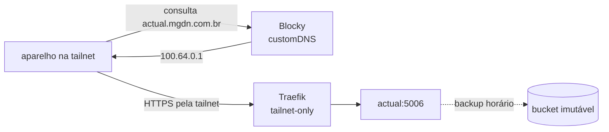

# Como adicionar um app

Este guia mostra como colocar um app novo na VM principal, acessível **só pela tailnet**,
com HTTPS e backup. Ele segue o mesmo padrão do Vaultwarden
([ADR 0010](adr/0010-dominio-proprio-traefik-e-vaultwarden.md)). O exemplo usa o
[Actual Budget](https://github.com/actualbudget/actual), um dos
[próximos passos](../README.md#próximos-passos); troque nome, imagem, porta e diretório de
dados pelos do seu app.



## 0. Antes de começar

| Pergunta | Por quê |
|---|---|
| **Cabe na RAM?** | A principal tem 2 GB, com ~1 GB disponível. Some os `mem_limit` de `deploy/primary/compose.yaml` e confira com `make status`. Apps que pedem Postgres, Redis ou workers de ML (Immich, Paperless) geralmente não cabem. |
| **Guarda dados?** | Se guarda, precisa de backup e restore (passo 5). Prefira apps com SQLite: o backup online do SQLite é consistente sem parar o app. |
| **Precisa de segredo?** | Segredo novo exige uma variável no Terraform, e mudar o cloud-init **recria a VM principal** (passo 2). Prefira apps que guardam a própria configuração no volume. |
| **Muda uma decisão?** | Um app comum não precisa de ADR. Um app que exige uma porta pública nova ou outra VM precisa. |

## 1. Serviço no Compose

Em `deploy/primary/compose.yaml`, adicione o serviço e o volume:

```yaml
services:
  actual:
    image: actualbudget/actual-server:<versão>@sha256:<digest>
    restart: unless-stopped
    volumes:
      - actual-data:/data
    mem_limit: 192m

volumes:
  actual-data:
```

- **Sem `ports:`.** O Traefik alcança o app pela rede do Compose. Publicar uma porta
  expõe o app na interface pública (o security group ainda filtra, mas é uma camada a menos).
- **Tag e digest juntos.** A tag diz a versão para quem lê; o digest garante que é a mesma
  imagem. Para obter o digest:

  ```bash
  docker buildx imagetools inspect actualbudget/actual-server:<versão> | grep -m1 Digest
  ```

- **`mem_limit` medido, não chutado.** Comece com folga, observe `docker stats` por uns
  dias e ajuste.
- **De graça:** o `supply-chain` passa a escanear a imagem com o Trivy, e o Dependabot
  passa a propor as atualizações. Os dois leem a lista de imagens do próprio Compose.

## 2. Segredos (só se o app precisar)

Pule este passo se o app guarda a configuração no volume, como o Actual Budget e o
Vaultwarden. Se o app precisa de um segredo vindo de fora:

1. Crie a variável em `infra/variables.tf` (`sensitive = true`) e coloque o valor no
   `terraform.tfvars`, que fica fora do Git.
2. Passe a variável no mapa `env` do `module "primary"`, em `infra/main.tf`. Ela chega à VM
   em `/etc/mgdn-platform/env`.
3. Em `scripts/gitops-sync.sh`, dentro de `apply()`, grave o segredo num arquivo com
   permissão restrita em `/etc/mgdn-platform/<app>/`, como já é feito para o Traefik e o
   Alertmanager. Monte esse diretório no container como `:ro`.
4. **Mudar o cloud-init recria a VM principal.** O `terraform-plan` do PR vai mostrar o
   aviso ⚠️. Antes do `make apply`, rode `make headscale-drain`.

## 3. Rota no Traefik

Em `deploy/primary/traefik/dynamic.yml`, adicione o router e o service:

```yaml
http:
  routers:
    actual:
      rule: Host(`actual.mgdn.com.br`)
      entryPoints: [websecure]
      service: actual
      middlewares: [tailnet-only, security-headers]
      tls:
        certResolver: cloudflare

  services:
    actual:
      loadBalancer:
        servers:
          - url: http://actual:5006
```

- **O `tailnet-only` é obrigatório.** Sem ele, quem souber o nome e o IP público acessa o
  app pela porta 443.
- O certificado sai por DNS-01, então o nome **não precisa existir no DNS público**.
- Quando o arquivo muda, o `gitops-sync` reinicia o Traefik. O arquivo entra no container
  por bind mount, e o `git checkout` troca o inode, então o watch sozinho não basta.

## 4. Nome na tailnet (split-horizon)

Em `deploy/common/blocky/config.yml`, adicione o nome ao `customDNS`:

```yaml
customDNS:
  mapping:
    vault.mgdn.com.br: 100.64.0.1
    actual.mgdn.com.br: 100.64.0.1
```

- **Não crie o registro na Cloudflare.** O nome só existe para quem usa o Blocky como DNS,
  ou seja, para os aparelhos da tailnet. Fora dela, o nome nem resolve.
- A configuração é comum aos dois papéis, então a secundária (`100.64.0.4`) também
  responde o nome.

## 5. Backup e restore (se o app guarda dados)

Use o Vaultwarden como modelo; cada script já tem o bloco dele.

1. **`scripts/backup.sh`:** copie o volume para `$work/<app>/` e acrescente `<app>` a
   `dirs`. Use `sqlite3 <db> ".backup '<destino>'"` nos bancos SQLite e confira o
   `PRAGMA integrity_check`. Copie os demais arquivos com `cp`.
2. **`scripts/restore.sh`:**
   - acrescente a opção `--<app>-target` e uma variável `need_<app>`, que respeita
     `--if-empty`;
   - acrescente o bloco que copia `$work/<app>/` para o volume.

   Backups antigos não têm o diretório do app, então o bloco precisa tolerar a ausência.
3. **`scripts/gitops-sync.sh`:** no primeiro deploy de uma VM nova,
   `compose create headscale vaultwarden traefik` cria os volumes antes do restore.
   Acrescente o serviço nessa lista, ou o restore não acha o volume de destino.
4. **`.github/workflows/dr-drill.yml`:** suba o app com os dados restaurados e confira que
   ele responde, como o drill faz com o Vaultwarden. Acrescente o resultado à tabela da issue.

Antes do merge, teste o caminho completo na VM:
`sudo systemctl start mgdn-backup.service` e depois
`sudo /opt/mgdn-platform/scripts/restore.sh --<app>-target /tmp/teste-restore`, conferindo
o conteúdo.

## 6. Monitoramento (opcional)

- Se o app expõe métricas Prometheus, adicione um job em
  `deploy/primary/prometheus/prometheus.yml`:

  ```yaml
  - job_name: actual
    static_configs:
      - targets: ["actual:5006"]
  ```

  O alerta `MonitoringTargetDown` (`up == 0`) passa a cobrir o app automaticamente.
- Se o app tiver um SLO próprio, crie as regras em `rules/`, os testes em `tests/` e um
  runbook em `docs/runbooks/`. O `deploy-config` roda os testes no CI.

## 7. PR, deploy e verificação

1. Abra o PR. Os checks validam o Compose, a configuração do Blocky e as regras, e o
   Trivy escaneia a imagem nova.
2. Depois do merge, as VMs aplicam em até ~2 min. Acompanhe com `make sync` ou
   `make status`.
3. Verifique:

   ```bash
   # de um aparelho na tailnet: resolve para 100.64.0.1 e abre
   dig +short actual.mgdn.com.br
   curl -sI https://actual.mgdn.com.br | head -1

   # de fora da tailnet, forçando o IP público: tem de dar 403
   curl -sI --resolve actual.mgdn.com.br:443:<IP público da principal> https://actual.mgdn.com.br | head -1
   ```

4. Se o app guarda dados, rode `make backup` e confira que o tamanho do backup cresceu
   (`make backups`).

## 8. Documentação

- No README, acrescente o app à tabela de componentes e, se tiver dados, à lista do que é
  salvo em *Backup e DR*.
- Atualize o comentário do topo de `deploy/primary/compose.yaml`, se mudar o que é exposto.
- Se o app saiu de *Próximos passos*, tire-o de lá.
