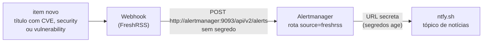

# FreshRSS

Leitor de RSS da principal em `freshrss.mgdn.com.br`, só pela tailnet e com HTTPS, gerado pelo
[`make new-app`](adicionar-app.md). Guarda tudo em SQLite, no volume, e entra no backup horário
e no DR drill pelos labels (ADR 0015).

> **Logo depois do deploy, crie a conta.** Até lá, o FreshRSS deixa qualquer aparelho da
> tailnet fazer a instalação. Todos os aparelhos são do dono, mas não deixe para depois.

## Criar a conta

Abra `https://freshrss.mgdn.com.br`. O assistente de instalação pede o idioma, confere os
requisitos, pergunta o banco (**SQLite**) e cria o usuário administrador.

## Ligar a API para apps de RSS

A API funciona atrás do Traefik: a versão fixada aceita `%2F` no caminho (o padrão do Traefik
3.7 é `allowEncodedSlash: true`), que a API Google Reader usa.

1. Em **Configurações → Autenticação**, marque *Permitir acesso à API (necessário para apps
   móveis)*.
2. Em **Configurações → Perfil**, preencha a *Senha da API*. Ela é diferente da senha
   principal, de propósito.
3. No mesmo campo há um link `https://freshrss.mgdn.com.br/api/`. Abra-o e use *Check full
   server configuration*. O esperado é **PASS**.

## App no iPhone

Com o Tailscale ligado no iPhone, num app que fale FreshRSS ou Google Reader (por exemplo
Reeder, NetNewsWire, Fiery Feeds ou Lire):

| Campo | Valor |
|---|---|
| Tipo de conta | FreshRSS, ou Google Reader |
| URL | `https://freshrss.mgdn.com.br/api/greader.php` |
| Usuário | o usuário do FreshRSS |
| Senha | a **senha da API** (não a principal) |

Apps que só falam Fever usam `https://freshrss.mgdn.com.br/api/fever.php`; o Google Reader é
mais completo e eficiente. O app só sincroniza com a tailnet ligada.

## Extensões

Três extensões oficiais do [FreshRSS/Extensions](https://github.com/FreshRSS/Extensions), na
versão da 1.30.4:

| Extensão | Para quê | Mínimo do FreshRSS |
|---|---|---|
| **Webhook** 0.2.6 | avisa o celular quando um item novo casa com um filtro | 1.28.2 |
| **Reading Time** 1.6.2 | tempo de leitura ao lado de cada item | sem mínimo declarado |
| **Title-Wrap** 0.3.1 | quebra títulos longos em vez de cortá-los | sem mínimo declarado |

A compatibilidade com a 1.30.4 foi conferida no código da 1.30.4 (hooks `entry_before_insert`
e `js_vars`, `Minz_View::appendStyle/appendScript`, `FreshRSS_http_Util::httpGet` com
`curl_options`, `Entry::matches` e o resto da API que elas chamam). Elas não foram executadas
numa instância: o primeiro uso real é o passo 3 abaixo.

**Como entram na VM.** O código fica copiado em `deploy/primary/freshrss/extensions/`,
exatamente como no commit de `extensions.lock` (nunca a `main`), e é montado só leitura,
uma extensão por vez, em `/var/www/FreshRSS/extensions/` (montar o diretório todo esconderia
as extensões que já vêm na imagem). Copiar em vez de baixar na VM tira a rede do caminho do
deploy, e o que roda é o que o PR mostrou. O CI confere que a cópia é idêntica ao commit.
Mudar os arquivos reinicia o `freshrss` pelo GitOps.

```bash
# atualizar: troque `commit` em deploy/primary/freshrss/extensions.lock, depois
scripts/freshrss-extensions.sh sync    # copia do commit; revise o diff antes do PR
scripts/freshrss-extensions.sh verify  # o que o CI roda
```

O Webhook é AGPL-3.0 e as demais têm a licença no próprio diretório; ficam como cópias do
original, sem alterações (o hook de formatação ignora esse diretório pelo mesmo motivo).

### Avisos de segurança no celular

Fluxo: o Webhook da FreshRSS faz um `POST` no Alertmanager, que manda ao ntfy.



**Por que passar pelo Alertmanager.** A extensão só lê a URL da configuração do usuário, que
fica no volume e é preenchida pela interface; não aceita variável de ambiente nem arquivo.
Pôr a URL do ntfy ali a deixaria fora dos segredos com age (ADR 0014) e dentro de cada backup
do volume. Apontando o Webhook para o Alertmanager, o que fica na configuração da FreshRSS é
só um endereço interno sem segredo, e a URL do ntfy continua em `ALERT_NEWS_NTFY_URL`, nos
segredos da principal, como as outras. A FreshRSS bloqueia pedidos a hosts internos; por isso
o `compose.yaml` libera só `alertmanager:9093` em `INTERNAL_HOST_ALLOWLIST`.

**Tópico próprio, não o dos alertas.** Recomendo separar: manchete de segurança de feed chega
em rajadas e com urgência baixa, e misturada aos alertas da plataforma (queda de DNS, disco,
backup) esconde o que importa ou ensina a ignorar o tópico. Com tópicos separados, dá para
silenciar um sem perder o outro. Se preferir um só, grave a mesma URL nas duas chaves; nada
mais muda.

**Ativar, nesta ordem** (cada passo depende do anterior):

1. Merge do PR e deploy. Na VM, um `sudo /opt/mgdn-platform/scripts/gitops-sync.sh --force`
   no fim garante que a versão nova do script gravou o arquivo da URL (o sync que traz o
   script novo ainda roda o antigo).
2. Crie um tópico aleatório no app do ntfy (assine-o no celular) e grave:
   `make secrets-set ROLE=primary KEY=ALERT_NEWS_NTFY_URL`, com o valor
   `https://ntfy.sh/<tópico>?template=alertmanager`. Um PR aplica, sem recriar a VM. Enquanto
   a chave não existir, o envio é desativado (não há erro).
3. Em **Configurações → Extensões**, ative as três. Em **Webhook**, preencha:

   | Campo | Valor |
   |---|---|
   | Filtro de busca | `intitle:CVE`, `intitle:security` e `intitle:vulnerabilit`, uma linha cada (linhas são "ou") |
   | Ignorar artigos atualizados | marcado (um aviso por item, não um a cada edição do feed) |
   | Método / URL | `POST` e `http://alertmanager:9093/api/v2/alerts` |
   | Tipo de corpo | Personalizado |
   | Corpo | o JSON abaixo |

   ```json
   [
     {
       "labels": {
         "alertname": "{title}",
         "source": "freshrss",
         "item": "{url}",
         "feed": "{feed_name}"
       },
       "annotations": {
         "summary": "{title}",
         "description": "{feed_name}: {url}"
       }
     }
   ]
   ```

   O filtro não diferencia maiúsculas e casa em qualquer parte do título; `vulnerabilit`
   pega *vulnerability* e *vulnerabilities*, que `vulnerability` sozinho não pegaria.
4. Teste com o botão de teste do Webhook (a mensagem chega com o título literal `{title}`, o
   que prova o caminho inteiro) e confira `docker compose logs alertmanager` se nada chegar.
   Os avisos aparecem no ntfy como "Alert: <título do item>", com o feed e o link na descrição.

O filtro e o corpo ficam na configuração do usuário (volume, entram no backup); não há
segredo neles. Se o volume for restaurado, a configuração volta junto.

## Memória

O limite (`mem_limit`) é estimado. Uma semana depois do merge, o workflow `deadlines` abre uma
issue para medir o pico real (`memory.peak` do cgroup e `docker stats`) e ajustar o limite,
mantendo-o em pelo menos 1,5x o pico.
